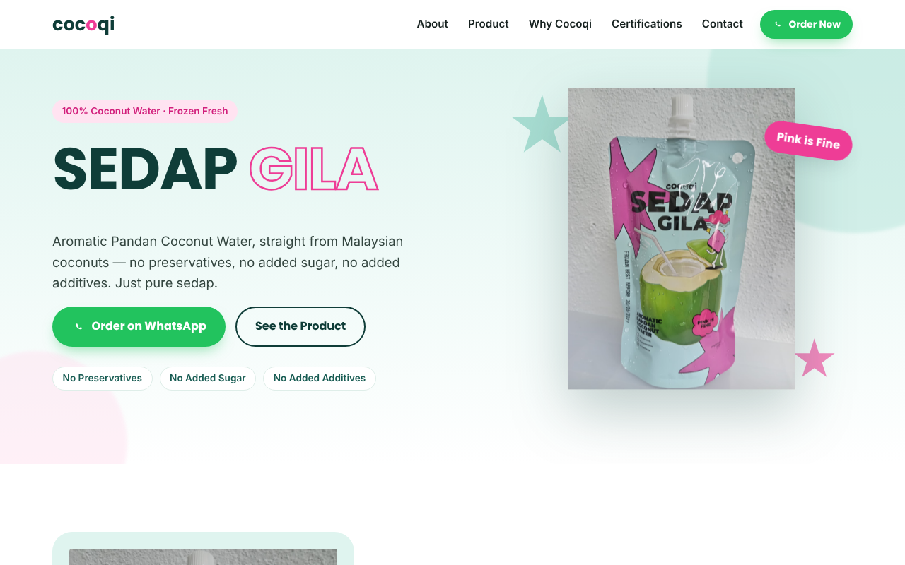
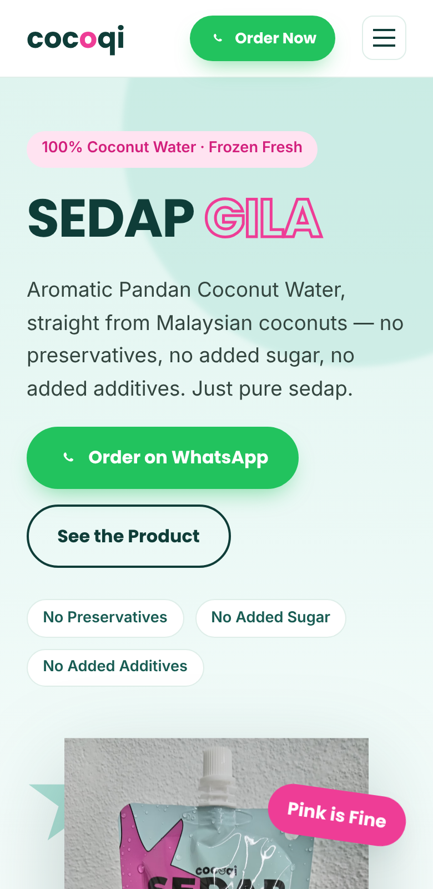

# cocoqi — Brand Website

Single-page marketing website for **cocoqi "Sedap Gila"**, a Malaysian aromatic pandan coconut water. Visitors learn about the product, view the two package editions and the food-safety certificates, and order directly over WhatsApp.

<p align="center">
  
  
</p>

## Highlights

- **No framework, no build step.** Plain HTML, CSS and vanilla JavaScript; loads fast and can be hosted anywhere (GitHub Pages).
- **Responsive layout** with a mobile navigation menu.
- **Accessible components:** skip-to-content link, `aria-expanded` on the menu toggle, and product tabs that follow the WAI-ARIA tabs pattern (roving `tabindex`, arrow-key navigation).
- **WhatsApp ordering:** call-to-action buttons open a pre-filled WhatsApp chat, which is how the business takes orders.
- **Trust section:** Halal, ISO 22000, HACCP, GMP, MeSTI and facility-registration certificates linked as PDFs.
- **SEO basics:** descriptive title and meta description.

## Structure

```
index.html          page content (About, Product, Why cocoqi, Certifications, Contact)
css/style.css       layout, theme and responsive rules
js/main.js          mobile nav, product tabs, footer year
assets/images/      product photos (pink and white editions)
assets/certs/       certificate PDFs
```

## Run locally

Open `index.html` in a browser, or serve the folder:

```sh
python3 -m http.server 8000
```
